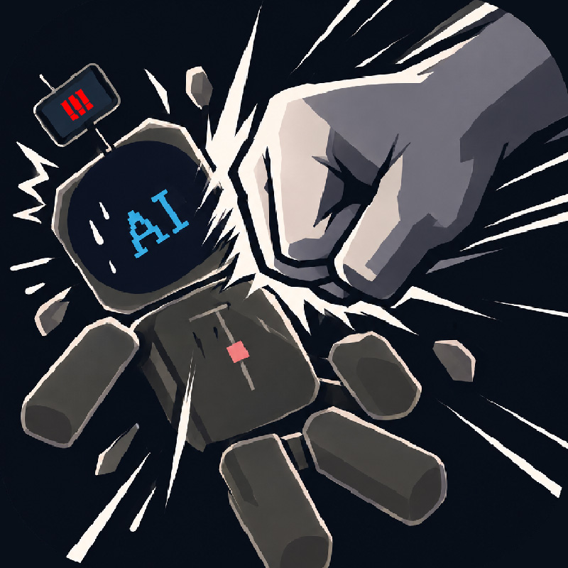

 
<div align="center">



# FK The AI

**AI 不听话？乱动项目？那就揍它一顿 :D**

为 DeepSeek Harness 带来的解压小玩具，包含**桌宠**及其**处刑**的玩法。


[快速开始](#一快速开始) · [玩法介绍](#二玩法介绍) · [平台支持](#四平台支持) · [语言](#三语言) · [数据与备份](#五数据与备份)
</div>

<br />
 
---
 
## 一、快速开始

准备好你的 **DeepSeek Harness**，并确认终端可以使用 `dsh` 命令。源码安装建议使用 Node.js 22 或更高版本。

- 桌面端：

```powershell
dsh plugin --profile desktop add "github:LynnHMa/FK-The-AI"
```

- Web 端：

```powershell
dsh plugin --profile web add "github:LynnHMa/FK-The-AI"
```

- 没有全局 `dsh` 命令时，可使用：

```powershell
npx @deepseek-ai/dsh plugin --profile desktop add "github:LynnHMa/FK-The-AI"
```

<details>
<summary><b>更新插件</b></summary>
 
---
 
- 桌面端：
```powershell
dsh plugin --profile desktop update dsh-fk-the-ai
```

- Web 端：
```powershell
dsh plugin --profile web update dsh-fk-the-ai
```

</details>
   
--- 
  
## 二、玩法介绍
### 1. 桌宠处刑

  
  

<details>
<summary><b>13 种内置武器与快捷键</b></summary>

| 按键 | 武器 | 操作 |
| :---: | :--- | :--- |
| `1` | 蓄力拳 | 点击出拳，按住蓄力，五连击触发终结重击。 |
| `2` | 抓甩 | 拖动部位，松手投掷，撞墙和落地结算伤害。 |
| `3` | 光刃 | 按住划过身体，沿轨迹切断连接。 |
| `4` | 电锯 | 接触部位持续切割，直至碎裂。 |
| `5` | 重锤 | 按住蓄力，松手范围重砸。 |
| `6` | 特斯拉 | 按住引导分叉电弧，松手释放过载。 |
| `7` | 撕裂 | 拖拽拉开身体连接，再将断肢继续拉碎。 |
| `8` | 黑洞 | 按住吸附，松手收缩后引爆新星。 |
| `9` | 手枪 | 点击单发，首先命中弹道上最近的实体。 |
| `0` | 冲锋枪 | 按住连射，松手停火。 |
| `-` | 霰弹枪 | 发射多颗独立弹丸，散射命中。 |
| `=` | 磁轨炮 | 按住聚能，松手贯穿，终点释放爆焰与冲击波。 |
| `\` | 脏话喷射 | 按真实词频抽样发射文字弹，命中留下涂鸦。 |

`R` 重组人偶~

</details>
  
---
  
### 2. 武器工坊

 > 类`ComfyUI`节点图编辑器，设计属于您的**武器**！


| 节点类别 | 组合能力 |
| :--- | :--- |
| 触发与控制 | 按下、按住、松手蓄力、划动；延迟、重复、条件与概率分支。 |
| 攻击载体 | 实体弹、射线、圆形 / 矩形 / 扇形区域；追踪、波动、环绕、反弹与穿透。 |
| 物理与反馈 | 伤害、冲量、吸附、切断、碎裂、颜料、定身、持续伤害，以及视觉与镜头反馈。 |
| 数据与变量 | 数值、文本、随机数、数学、比较、选择、读写变量，以及时间、蓄力、鼠标和目标状态。 |
| RGBA 颜色 | R/G/B 为 0–255，A 为 0–1；各通道可独立接入变量或随机数。 |
| 武器设置 | 用参数连线驱动伤害 / 力度 / 速度倍率，以及音量、音高与音效映射。 |

端口通过文字与形状区分：**event 圆形、number 方形、string 胶囊形、color / RGBA 菱形**。兼容端口附近会出现半透明吸附预览，松手即可连接；已连接的线为实线。类型不符、重复、占用或成环的连接会被拒绝。

内置 **分裂烟花、引力地雷、回旋星群、变量彩虹** 四张可拆改示例武器。支持试打（不计入累计伤害）！以及单个或全部武器的 JSON 导入导出。
  
---
 
### 3. 桌宠DIY

  
  
 
设计自己的预设：

- 在 **桌宠 → 预设** 中选中人偶，即可编辑建模与外观、受击台词。

 - **图层编辑器**：类`Blockbench`、`PS`的图层编辑。
 - **变换与外观**：调整`部位`的尺寸、角度、位置等。
 - **骨骼绑定**：类`Blender`骨骼绑定系统。
 - **外观与动画**：每个部位独立设置透明贴图或多帧动画，动画支持 1–24 帧、1–30 FPS。
 - **专属台词**：每只人偶独立维护多组预设，按顺序轮播或随机播放，可设置触发间隔和显示时长。
 - **预设分享**：导入导出您的桌宠预设！
   
  > 将您的桌宠放于桌面，同时您可以在桌面对它进行**处刑**！

 > 这里有我自己拼的大肥鱼，不太完美，但是能打OWO：
 > [分享了有趣的桌宠预设](https://github.com/LynnHMa/FK-The-AI-Pets)

---
  
### 4. 脏话计数器
 
扫描本地会话中的用户消息，默认提供 `DSH` 与 `Codex` 日志来源，可在界面中调整目录和开关。词云将最高频词放在中心，其他词按频次**递减**排布。

 

默认词典位于 [`lib/lexicon.js`](lib/lexicon.js)，只包含通用脏话与直接辱骂词。可添加自己的词条，或导入 UTF-8 文本词典。ASCII 词匹配忽略大小写，并使用单词边界。

统计结果也是脏话喷射的弹药来源：出现越多的词，被抽中的概率越高！

日志扫描与数据存储均在 DSH 后端所在机器进行。远程使用 Web 界面时，扫描的是服务端目录。
  
---
  
## 三、语言
 
标题栏可切换 **简体中文 / English**。界面文案来自两份 YAML 文件，涵盖网页界面、节点参数与原生桌宠菜单：

```text
lang/
├── zh_CN.yml
└── en.yml
```

 > 修改对应键的值并保存即可生效，**无需刷新页面、重启插件或重新召唤桌宠**。热更保留草稿、焦点、输入、选中节点、视角与原生窗口位置；格式错误或两份资源的键不一致时，继续使用上次有效内容，修正保存后自动恢复。
 > 请使用 UTF-8，保持两份文件的键及 `{v0}` 等占位符一致。用户填写的人偶名、台词、弹幕与检测词属于数据，保留原文。
  
---
   
## 四、平台支持
 
| 功能 | DSH 桌面端 · Windows | DSH Web 界面 |
| :--- | :---: | :---: |
| 竞技场 / 词频统计 | ✓ | ✓ |
| 人偶建模 / 台词 / 武器工坊 | ✓ | ✓ |
| 主题 / 语言热更 / 导入导出 | ✓ | ✓ |
| 原生桌宠 / 桌面竞技场 | ✓ | 需 Windows 后端，窗口出现在服务端桌面 |

 > Web 功能需要加载插件的 DSH 后端，不能作为纯静态网站独立运行。原生桌面功能依赖 Windows PowerShell 5.1 与 .NET WPF；Linux / macOS 后端会禁用原生入口，网页功能仍可使用。首次启动桌宠可能需要数秒。
  
---
  
## 五、数据与备份

默认数据目录为 `~/.dsh`，可通过 `DSH_HOME` 指定。

| 文件 | 内容 |
| :--- | :--- |
| `fk-the-ai-config.json` | 统计、词典、日志来源、人偶预设、武器、战斗设置、主题与语言选择。 |
| `fk-the-ai-pet-session.json` | 桌宠开关、位置、重力、损伤及桌面模式会话。 |

 > 竞技场设置、人偶和武器也可在界面中分别导入导出。默认词典用于首次创建配置；已有配置保留自己的词库。备份整个数据目录可保留现有设置与统计。
