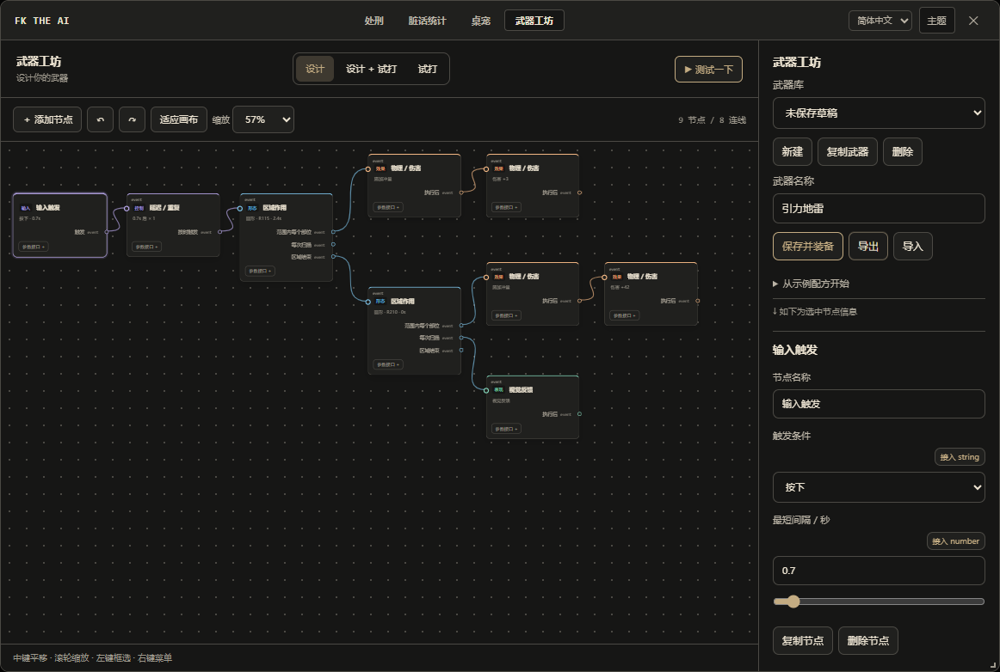
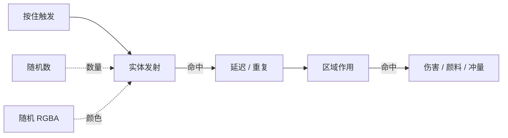

<div align="center">


# FK The AI

**AI 不听话？乱动项目？那就揍它一顿。**

为 DeepSeek Harness 带来物理解压竞技场、桌面人偶与可编程武器工坊。


[快速开始](#快速开始) · [功能一览](#功能一览) · [武器工坊](#武器工坊) · [平台支持](#平台支持) · [开发](#开发)

</div>

<br />



<p align="center"><sub>真实界面截图 · 引力地雷示例事件图 · 所有节点均可拆改</sub></p>

## 功能一览

| 模块 | 可以做什么 |
| :--- | :--- |
| **竞技场** | 13 种内置武器，蓄力、抓甩、切割、连射、撕裂与黑洞；自由调节打击反馈、物理、粒子和声音。 |
| **脏话统计** | 扫描本地 DSH / Codex 会话，展示词频、来源与中心聚集词云，让高频词变成文字弹药。 |
| **桌宠** | 让人偶出现在 Windows 桌面，拖动、抛掷、开关重力；编辑预设、部位、贴图、动画与专属受击台词。 |
| **武器工坊** | 用事件流和参数连线设计武器，加入变量、随机数、RGBA 颜色与条件分支，边设计边试打。 |

窗口支持拖动缩放、侧栏折叠。六套主题各有深浅模式，可跟随系统或自定义颜色；桌宠的菜单与气泡同步主题。

## 快速开始

准备好已安装的 **DeepSeek Harness**，并确认终端可以使用 `dsh` 命令。源码安装建议使用 Node.js 22 或更高版本。

### 1. 安装依赖

下载或克隆本仓库，进入项目目录：

```powershell
cd "D:\Plugins\FK The AI"
npm ci --omit=dev
```

### 2. 加载插件

将下面的路径替换为实际项目目录：

```powershell
dsh plugin --profile desktop add link:"D:\Plugins\FK The AI"
```

这里使用 DSH 的 `desktop` 配置。其他配置请替换为对应 profile；Web 界面需要在提供服务的 DSH 实例中加载插件。

### 3. 打开竞技场

重新打开 DSH，点击页面上的 **FK The AI 悬浮按钮**，即可进入插件。顶部可切换竞技场、脏话统计、桌宠与武器工坊。

- 想直接开打：选择武器，点击或按住人偶。
- 想换个人偶：进入 **桌宠 → 桌宠预设**，添加预设并编辑外观。
- 想使用桌面模式：开启 **桌宠显示**，悬停人偶后从图标菜单进入桌面竞技场。
- 想用自己的词频发射弹幕：在 **脏话统计** 中确认日志来源，执行全量重扫。

更新代码或依赖后，重新加载插件以启用新的后端模块；语言文件的修改会自动热更。

## 竞技场

拳头蓄力、子弹撞墙、关节断开、碎片落地，都有对应的反馈。透明贴图按实际 Alpha 轮廓判断命中，透明边距和内部空洞不会挡住攻击；碎片保留原贴图。

右侧设置按功能分组，可调整伤害、击退、重力、弹性、人偶尺寸、时间速度、震屏、停顿、镜头、粒子、液体颜色与透明度。武器可分别设置倍率，并为攻击、命中、蓄力、释放、空击上传音效。

<details>
<summary><b>查看 13 种内置武器与快捷键</b></summary>

| 按键 | 武器 | 操作 |
| :---: | :--- | :--- |
| `1` | 蓄力拳 | 点击出拳，按住蓄力，五连击触发终结重击。 |
| `2` | 抓甩 | 拖动部位，松手投掷，撞墙和落地结算伤害。 |
| `3` | 光刃 | 按住划过身体，沿轨迹切断连接。 |
| `4` | 电锯 | 接触部位持续切割，直至碎裂。 |
| `5` | 重锤 | 按住蓄力，松手范围重砸。 |
| `6` | 特斯拉 | 按住引导分叉电弧，松手释放过载。 |
| `7` | 撕裂 | 拖拽拉开身体连接，再将断肢继续拉碎。 |
| `8` | 黑洞 | 按住吸附，松手收缩后引爆新星。 |
| `9` | 手枪 | 点击单发，首先命中弹道上最近的实体。 |
| `0` | 冲锋枪 | 按住连射，松手停火。 |
| `-` | 霰弹枪 | 发射多颗独立弹丸，散射命中。 |
| `=` | 磁轨炮 | 按住聚能，松手贯穿，终点释放爆焰与冲击波。 |
| `\` | 脏话喷射 | 按真实词频抽样发射文字弹，命中留下涂鸦。 |

`R` 重组人偶；`Esc` 关闭当前竞技场，桌面模式下返回桌宠。空击不计伤害，重组与切换武器不会清空累计伤害。

</details>

## 武器工坊

**把攻击方式画成一张图。** 事件端口决定何时执行，数据端口决定使用什么参数。同一事件可以分出多条路径，参数可以由变量或其他节点提供。



| 节点类别 | 组合能力 |
| :--- | :--- |
| 触发与控制 | 按下、按住、松手蓄力、划动；延迟、重复、条件与概率分支。 |
| 攻击载体 | 实体弹、射线、圆形 / 矩形 / 扇形区域；追踪、波动、环绕、反弹与穿透。 |
| 物理与反馈 | 伤害、冲量、吸附、切断、碎裂、颜料、定身、持续伤害，以及视觉与镜头反馈。 |
| 数据与变量 | 数值、文本、随机数、数学、比较、选择、读写变量，以及时间、蓄力、鼠标和目标状态。 |
| RGBA 颜色 | R/G/B 为 0–255，A 为 0–1；各通道可独立接入变量或随机数。 |
| 武器设置 | 用参数连线驱动伤害 / 力度 / 速度倍率，以及音量、音高与音效映射。 |

端口通过文字与形状区分：**event 圆形、number 方形、string 胶囊形、color / RGBA 菱形**。兼容端口附近会出现半透明吸附预览，松手即可连接；已连接的线为实线。类型不符、重复、占用或成环的连接会被拒绝。

内置 **分裂烟花、引力地雷、回旋星群、变量彩虹** 四张可拆改示例图。支持草稿试打、保存并装备，以及单个或全部武器的 JSON 导入导出。保存后的武器可用于普通竞技场和桌面竞技场，草稿试打不计入累计伤害。

<details>
<summary><b>画布操作与快捷键</b></summary>

| 操作 | 方式 |
| :--- | :--- |
| 平移 / 缩放 | 中键拖动或空格 + 左键；滚轮以鼠标为中心缩放。 |
| 多选 / 移动 | 空白处左键框选，Shift 追加；拖动选中节点标题整体移动。 |
| 连接 | 从输出拖到输入，或依次点击；展开参数接口可连接指定参数。 |
| 添加 / 菜单 | `Tab` 添加节点；右键打开编辑菜单。 |
| 复制 / 剪切 / 粘贴 | `Ctrl+C` / `Ctrl+X` / `Ctrl+V`。 |
| 全选 / 副本 / 保存 | `Ctrl+A` / `Ctrl+D` / `Ctrl+S`。 |
| 撤销 / 重做 | `Ctrl+Z` / `Ctrl+Shift+Z` 或 `Ctrl+Y`。 |
| 删除 / 适应画布 | `Delete` 或 `Backspace`；`F` 或 `Home`。 |
| 取消当前操作 | 点击其他区域或按 `Esc`，关闭弹窗与悬空连线。 |

单个武器最多 48 个节点、96 条连线、16 层事件链。需要重复时使用重复节点；运行时还有弹体与任务预算，避免事件无限扩张。

</details>

## 桌宠与人偶设计

### 设计自己的预设

在 **桌宠 → 桌宠预设** 中选中人偶，即可编辑建模与外观、受击台词。

- **自由建模**：1–24 个部位，可增删、改名、调整父连接；直接拖动移位，拖拽八个缩放手柄调整大小，支持撤销和重做。
- **换肤与动画**：每个部位独立设置透明贴图或多帧动画，动画支持 1–24 帧、1–30 FPS。
- **专属台词**：每只人偶独立维护多组预设，按顺序轮播或随机播放，可设置触发间隔和显示时长。
- **预设分享**：导入导出包含部位、连接、贴图、动画与台词；人偶文件导入追加为新预设。

### 把人偶放到桌面

桌宠使用 Windows 原生透明置顶窗口。拖拽带有牵引、摆动和惯性，松手后受重力与屏幕工作区边缘影响；重力可独立关闭，调整模型尺寸后碰撞范围同步更新。

悬停显示名称与图标菜单，双击可恢复最小化或托盘中的 DSH 窗口。菜单支持打开竞技场、脏话统计和桌面竞技场；桌宠显示开关、位置、重力与损伤状态会保存，并在下次启动时恢复。

**桌面竞技场** 将战场扩展到桌宠所在的整个屏幕。内置武器和自定义武器共用战斗引擎，DSH 最小化后仍可攻击；累计伤害共享，退出后颜料、涂鸦、断肢和碎片同步回竞技场及桌宠。

## 脏话统计

扫描本地会话中的用户消息，过滤代码块、行内代码、URL 和路径等技术噪声。默认提供 DSH 与 Codex 日志来源，可在界面中调整目录和开关。词云将最高频词放在中心，其他词按频次递减排布，悬停查看次数与占比。

默认词典位于 [`lib/lexicon.js`](lib/lexicon.js)，只包含通用脏话与直接辱骂词。可添加自己的词条，或导入 UTF-8 文本词典。ASCII 词匹配忽略大小写，并使用单词边界。

统计结果也是脏话喷射的弹药来源：出现越多的词，被抽中的概率越高。竞技场 **武器设置 → 脏话显示为星号** 可遮罩文字弹、涂鸦和对应伤害标签，保留原始统计数据。

日志扫描与数据存储均在 DSH 后端所在机器进行。远程使用 Web 界面时，扫描的是服务端目录。

## 语言与热更新

标题栏可切换 **简体中文 / English**。界面文案来自两份 YAML 文件，涵盖网页界面、节点参数与原生桌宠菜单：

```text
lang/
├── zh_CN.yml
└── en.yml
```

修改对应键的值并保存即可生效，**无需刷新页面、重启插件或重新召唤桌宠**。热更保留草稿、焦点、输入、选中节点、视角与原生窗口位置；格式错误或两份资源的键不一致时，继续使用上次有效内容，修正保存后自动恢复。

请使用 UTF-8，保持两份文件的键及 `{v0}` 等占位符一致。用户填写的人偶名、台词、弹幕与检测词属于数据，保留原文。

## 平台支持

| 功能 | DSH 桌面端 · Windows | DSH Web 界面 |
| :--- | :---: | :---: |
| 竞技场 / 词频统计 | ✓ | ✓ |
| 人偶建模 / 台词 / 武器工坊 | ✓ | ✓ |
| 主题 / 语言热更 / 导入导出 | ✓ | ✓ |
| 原生桌宠 / 桌面竞技场 | ✓ | 需 Windows 后端，窗口出现在服务端桌面 |

Web 功能需要加载插件的 DSH 后端，不能作为纯静态网站独立运行。原生桌面功能依赖 Windows PowerShell 5.1 与 .NET WPF；Linux / macOS 后端会禁用原生入口，网页功能仍可使用。首次启动桌宠可能需要数秒。

## 数据与备份

默认数据目录为 `~/.dsh`，可通过 `DSH_HOME` 指定。

| 文件 | 内容 |
| :--- | :--- |
| `fk-the-ai-config.json` | 统计、词典、日志来源、人偶预设、武器、战斗设置、主题与语言选择。 |
| `fk-the-ai-pet-session.json` | 桌宠开关、位置、重力、损伤及桌面模式会话。 |

竞技场设置、人偶和武器也可在界面中分别导入导出。默认词典用于首次创建配置；已有配置保留自己的词库。备份整个数据目录可保留现有设置与统计。

## 开发

```powershell
npm ci
npm test
npm run preview
```

预览命令会输出本地地址，使用隔离的临时配置，不读写实际 DSH 数据。

| 命令 | 验证范围 |
| :--- | :--- |
| `npm test` | 本地化检查、战斗设置、持久化与基础 API。 |
| `npm run test:browser` | 浏览器战斗、人偶与界面交互。 |
| `npm run test:workshop` | 事件图、数据节点、编辑器及桌面 Worker 执行。 |
| `npm run test:interaction` | 模块导航、窗口缩放、画布交互与参数连线。 |
| `npm run test:i18n` | 中英切换、YAML 热更、错误恢复、端口与磁吸。 |
| `npm run test:theme` | 主题切换与深浅配色。 |
| `npm run test:collision` | 透明轮廓、空洞与全屏边界。 |
| `npm run test:desktop-session` | Windows 原生会话恢复与状态保存。 |
| `npm run test:i18n-native` | Windows 原生菜单语言切换与热更。 |

浏览器测试默认使用本机 Edge；部分脚本支持通过 `FK_BROWSER` 指定 Chromium 路径。原生测试需要 Windows 桌面会话，可能短暂移动鼠标或创建测试窗口。

```text
assets/       浏览器界面、物理战斗、节点图与共享运行器
lib/          DSH 插件、扫描、存储、桌面 Worker 与 WPF 窗口
lang/         双语文案
docs/images/  README 界面预览
tests/        单元、浏览器及 Windows 原生验证
```

新增界面文案必须进入两份语言文件，禁止在代码里硬编码。提交前运行 `npm run check:i18n` 与对应模块测试；具体约束见 [`AGENTS.md`](AGENTS.md)。
